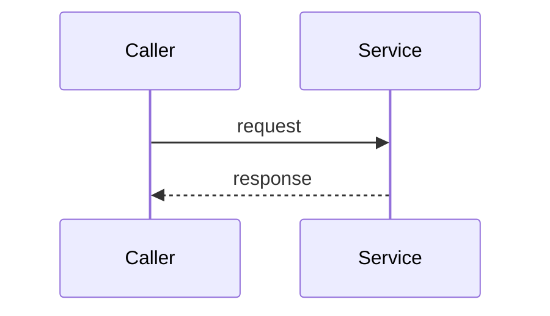

# Review Spec: <change name>

**Repo:** <owner/repo> · **Change:** <PR or stack, e.g. #4 → #5 → #7> · **Head:** <branch @ short SHA> · **Date:** <YYYY-MM-DD>

This document is the review contract. Check the code against it:
- **Section 3:** the rules that must hold, each with where it is enforced and what proves it.
- **Section 4:** the only behaviour changes intended. Anything else in the diff is a finding.
- **Section 5:** accepted limitations. Don't report these.
- **Section 6:** findings already fixed. Don't report these again.
- **Section 7:** commands to verify everything.

## 1. Context

Two to five sentences: what the system does, what this change adds, and the one constraint that shapes it (for example, "requests without the new field must behave exactly as before").



[Open in Mermaid Live](<link from scripts/mermaid.py>)

## 2. Change map

| PR | Branch (base) | Code / test lines | Changes |
|---|---|---|---|
| #N | `branch` (`base`) | +X / +Y | the files and concepts it introduces |

Line references below are at `<head branch @ SHA>`.

## 3. Rules the code must keep

### Backward compatibility

| ID | Rule | Enforced at | Proved by |
|---|---|---|---|
| BC-1 | One observable statement | `path/file.py:42` `function` | `test_name` |
| BC-2 | ... | ... | **No direct test.** What to read instead |

### <Group: e.g. new engine, auth, data, infrastructure>

| ID | Rule | Enforced at | Proved by |
|---|---|---|---|
| XX-1 | ... | ... | ... |

## 4. Intended behaviour changes (complete list)

Anything outside this list that changes behaviour is a finding.

1. ...

## 5. Accepted limitations (don't report)

| Limitation | Why it is accepted |
|---|---|
| ... | product decision / external constraint / pending access, and when it gets revisited |

## 6. Already-resolved findings (don't report)

| Finding (source) | Fix |
|---|---|
| ... (bot, CI, earlier review) | what changed, in which PR |

## 7. How to verify

```bash
# checkout, install, run the tests, run infra validation: exactly as CI does
```

- Any per-rule check that needs its own command (a grep, a migration up/down, a live call), with the expected result.

**Evidence already collected:** CI per PR, live runs, migration runs, each with its real result.

**Not yet verified:** each item, why, and when it will be.

## 8. Deployment order (for context)

The numbered steps, and which order constraints matter (for example, "migrate before deploying workers").
